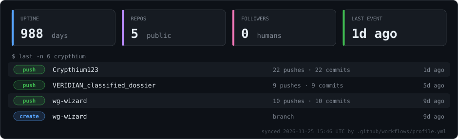

  

  
  
  
  
  
  

 

## `> tcpdump -X -c 1`

A real IPv4/TCP packet, rebuilt every morning by a GitHub Action: fresh TCP timestamp, checksums recomputed.
Download [`crypthium.pcap`](assets/crypthium.pcap) and open it in Wireshark — it parses.

## `> last`

<picture>
  <source media="(prefers-color-scheme: dark)" srcset="https://raw.githubusercontent.com/Crypthium123/Crypthium123/output/snake-dark.svg" />
  
</picture>

## `> ping`

  
  

 

<code>sha256(?) = 7a899090ccbf795d3f1efa0e373a32cf1d4bf9c0e2ee50fe6a5526a2a80f76eb</code>

